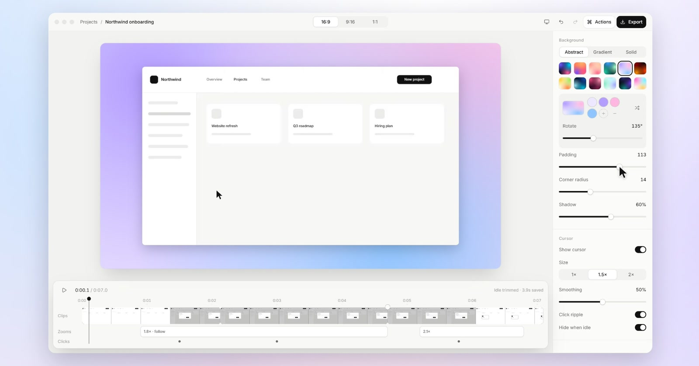
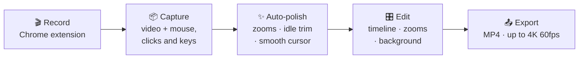

<div align="center">

<picture>
  <source media="(prefers-color-scheme: dark)" srcset=".github/assets/logo-dark.svg">
  
</picture>

# Buffer Clip

**Turn screen recordings into polished product demos — automatically.**

Record a tab, and Buffer Clip adds smooth zooms on your clicks, trims the idle time,<br>
styles the frame and exports a crisp MP4. All in your browser, nothing uploaded.

<br>


<br>


[](LICENSE)

[**Features**](#features) · [**How it works**](#how-it-works) · [**Getting started**](#getting-started) · [**Project structure**](#project-structure)

<br>



</div>

<br>

<a id="features"></a>

## ✨ Features

| Feature | What you get |
|:---|:---|
| 🎬 **Record** | A Chrome extension records the current tab or a dragged area, with a 3-2-1 countdown, a live timer and a stop shortcut (`Alt+Shift+S`). |
| 🔍 **Auto-zooms** | Smooth zooms are generated from your clicks and typing. Move, resize or retune them, follow the cursor, or **draw a box** on the preview to zoom into exactly that area. |
| ✂️ **Idle trim** | Pauses are detected and trimmed or sped up for you. Bring any of them back with one click. |
| 🎞️ **Timeline** | Clips show frame thumbnails. Trim from either edge, split at the playhead, with full undo and redo. |
| 🎨 **Styling** | Abstract, gradient and solid backgrounds with a gradient editor, plus padding, rounded corners, shadow and a smoothed cursor with click ripples. |
| 📐 **Aspect ratios** | 16:9, 9:16 and 1:1. The preview morphs between them smoothly. |
| 📤 **4K export** | Export MP4 at 1080p or 4K, 30 or 60fps, encoded in the browser. The export matches the preview frame for frame. |
| ⌨️ **Speed** | ⌘K / Ctrl+K command palette, keyboard shortcuts, light and dark themes, and a hands-on guided tour. |

> [!NOTE]
> Buffer Clip is local-first: recordings and projects live in your browser's storage and never leave your machine. It needs **Chrome or Edge**, which provide the tab capture and video encoding it uses.

<a id="how-it-works"></a>

## ⚙️ How it works



1. **Record:** the extension films your tab and logs every mouse move, click, key press and scroll next to the video.
2. **Auto-polish:** the editor reads those events to place zooms where you clicked, cut the moments where nothing happened, and smooth the cursor path.
3. **Edit and export:** fine-tune anything on the timeline. The preview and the export draw every frame with the same renderer, so what you see is exactly what you get.

<a id="getting-started"></a>

## 🚀 Getting started

**Requirements:** Node.js 20+, pnpm 9+, and Chrome or Edge.

**1. Install and run the app** (it opens on http://localhost:3000):

```bash
pnpm install
pnpm dev
```

**2. Build the extension:**

```bash
pnpm --filter @buffer-clip/extension build
```

**3. Load it in Chrome:**
1. Open `chrome://extensions` and turn on **Developer mode**.
2. Click **Load unpacked** and choose `apps/extension/dist`.
3. Pin Buffer Clip, open any website and click its icon to record.

> [!TIP]
> No extension yet? Click **How to use** in the app. It generates a sample recording and walks you through the editor in a hands-on tour.

<details>
<summary><b>Tests and production builds</b></summary>

<br>

```bash
pnpm test                                   # unit tests: core, extension, web
pnpm typecheck                              # TypeScript across the workspace
pnpm --filter @buffer-clip/web e2e          # end-to-end tests (Playwright)
pnpm --filter @buffer-clip/web build        # production build of the web app
```

To point the extension at a deployed copy of the app instead of localhost:

```bash
APP_ORIGIN=https://your-app.example pnpm --filter @buffer-clip/extension build
```

</details>

<a id="project-structure"></a>

## 🗂️ Project structure

```text
buffer-clip/
├── apps/
│   ├── web/         # Next.js app: project library, editor, export
│   └── extension/   # Chrome extension (MV3): recording and hand-off to the editor
├── packages/
│   └── core/        # Engine in pure TypeScript: time mapping, zooms, idle detection, camera, rendering
└── demo/            # Scripts that produce the launch demo video from the real app
```

## 📄 License

Released under the [MIT License](LICENSE).

<div align="center">
<br>
<sub>Record. Polish. Share.</sub>
</div>
